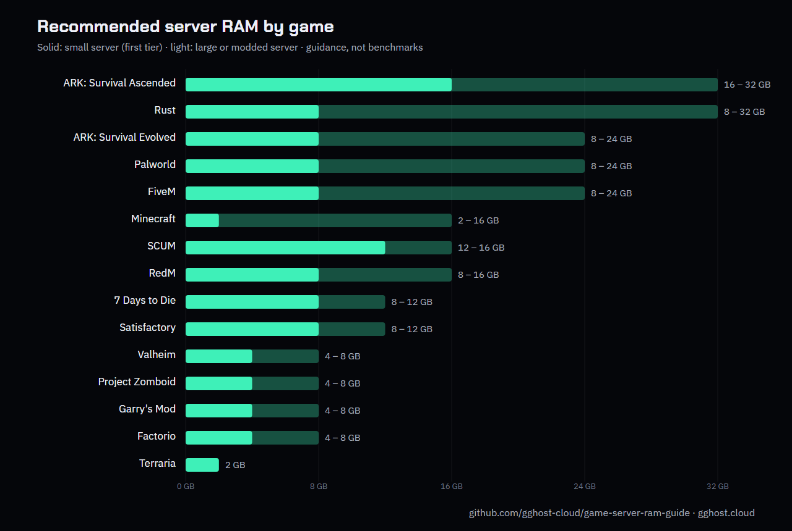

  

  
  
  

# Game server RAM guide

How much memory does a dedicated game server need? This guide gives practical RAM sizing for **15 popular games**, by player count, from the team that runs them in production at [GGHOST Cloud](https://gghost.cloud/?utm_source=github&utm_medium=referral&utm_campaign=ram-guide).

> These figures are where we size real servers: enough headroom that a raid, a boss fight or an autosave doesn't cause lag, without paying for memory that sits idle. They are guidance, not benchmarks. Mods, plugins, map size and world age all move them.

## Contents

1. [At a glance](#at-a-glance)
2. [Sizing by game](#sizing-by-game)
3. [What changes the numbers](#what-changes-the-numbers)
4. [How to choose](#how-to-choose)
5. [FAQ](#faq)
6. [Contributing](#contributing)
7. [License](#license)
8. [About GGHOST Cloud](#about-gghost-cloud)

## At a glance

  

| Game | Category | Small server | Large or modded |
|---|---|---|---|
| [Minecraft](#minecraft) | Survival | 2 GB | 8 – 16 GB |
| [Rust](#rust) | Survival | 8 GB | 32 GB |
| [ARK: Survival Ascended](#ark-survival-ascended) | Survival | 16 GB | 32 GB+ |
| [ARK: Survival Evolved](#ark-survival-evolved) | Survival | 8 GB | 24 GB+ |
| [Palworld](#palworld) | Survival | 8 GB | 24 GB |
| [SCUM](#scum) | Survival | 12 GB | 16 GB |
| [Valheim](#valheim) | Survival | 4 GB | 8 GB |
| [7 Days to Die](#7-days-to-die) | Survival | 8 GB | 12 GB |
| [Project Zomboid](#project-zomboid) | Survival | 4 GB | 8 GB |
| [Terraria](#terraria) | Survival | 2 GB | — |
| [Garry's Mod](#garrys-mod) | Sandbox | 4 GB | 8 GB |
| [Satisfactory](#satisfactory) | Sandbox | 8 GB | 12 GB |
| [Factorio](#factorio) | Sandbox | 4 GB | — |
| [FiveM](#fivem) | Roleplay | 8 GB | 24 GB+ |
| [RedM](#redm) | Roleplay | 8 GB | 16 GB |

## Sizing by game

### Survival

#### Minecraft

| Players | RAM | Notes |
|---|---|---|
| Up to 10 | **2 GB** | Vanilla or a light plugin set |
| 10 – 40 | **4 – 8 GB** | Paper with plugins, or a small modpack |
| 40+ | **8 – 16 GB** | Large modpacks want memory, not slots |

→ [Minecraft server hosting](https://gghost.cloud/games/minecraft/?utm_source=github&utm_medium=referral&utm_campaign=ram-guide)

#### Rust

| Players | RAM | Notes |
|---|---|---|
| Up to 50 | **8 GB** | Vanilla or a light plugin set |
| 50 – 150 | **16 GB** | Typical modded server |
| 150+ | **32 GB** | Large map with a heavy plugin stack |

→ [Rust server hosting](https://gghost.cloud/games/rust/?utm_source=github&utm_medium=referral&utm_campaign=ram-guide)

#### ARK: Survival Ascended

| Players | RAM | Notes |
|---|---|---|
| Up to 20 | **16 GB** | Single map, light mods |
| 20 – 50 | **24 GB** | Single map, heavy mods |
| Cluster | **32 GB+** | Each map in a cluster wants its own headroom |

→ [ARK: Survival Ascended server hosting](https://gghost.cloud/games/ark-ascended/?utm_source=github&utm_medium=referral&utm_campaign=ram-guide)

#### ARK: Survival Evolved

| Players | RAM | Notes |
|---|---|---|
| Up to 20 | **8 GB** | Single map, light mods |
| 20 – 70 | **16 GB** | Single map, modded |
| Cluster | **24 GB+** | Per map in the cluster |

→ [ARK: Survival Evolved server hosting](https://gghost.cloud/games/ark-evolved/?utm_source=github&utm_medium=referral&utm_campaign=ram-guide)

#### Palworld

| Players | RAM | Notes |
|---|---|---|
| Up to 8 | **8 GB** |  |
| 8 – 16 | **16 GB** |  |
| 16 – 32 | **24 GB** | Above the official recommendation |

→ [Palworld server hosting](https://gghost.cloud/games/palworld/?utm_source=github&utm_medium=referral&utm_campaign=ram-guide)

#### SCUM

| Players | RAM | Notes |
|---|---|---|
| Up to 32 | **12 GB** |  |
| 32 – 64 | **16 GB** | Or a heavily modded island |

→ [SCUM server hosting](https://gghost.cloud/games/scum/?utm_source=github&utm_medium=referral&utm_campaign=ram-guide)

#### Valheim

| Players | RAM | Notes |
|---|---|---|
| Up to 10 | **4 GB** | Comfortable for a normal group |
| 10 – 20 | **8 GB** | Or a long-running modded world |

→ [Valheim server hosting](https://gghost.cloud/games/valheim/?utm_source=github&utm_medium=referral&utm_campaign=ram-guide)

#### 7 Days to Die

| Players | RAM | Notes |
|---|---|---|
| Up to 8 | **8 GB** |  |
| 8 – 16 | **12 GB** | Or a large overhaul mod |

→ [7 Days to Die server hosting](https://gghost.cloud/games/7-days-to-die/?utm_source=github&utm_medium=referral&utm_campaign=ram-guide)

#### Project Zomboid

| Players | RAM | Notes |
|---|---|---|
| Up to 8 | **4 GB** |  |
| 8 – 32 | **8 GB** | Modded groups want the headroom |

→ [Project Zomboid server hosting](https://gghost.cloud/games/project-zomboid/?utm_source=github&utm_medium=referral&utm_campaign=ram-guide)

#### Terraria

| Players | RAM | Notes |
|---|---|---|
| Up to 16 | **2 GB** | More for large tModLoader packs |

→ [Terraria server hosting](https://gghost.cloud/games/terraria/?utm_source=github&utm_medium=referral&utm_campaign=ram-guide)

### Sandbox

#### Garry's Mod

| Players | RAM | Notes |
|---|---|---|
| Up to 32 | **4 GB** | Light addon list |
| 32 – 64 | **8 GB** | Large Workshop collection |

→ [Garry's Mod server hosting](https://gghost.cloud/games/garrys-mod/?utm_source=github&utm_medium=referral&utm_campaign=ram-guide)

#### Satisfactory

| Players | RAM | Notes |
|---|---|---|
| Up to 4 | **8 GB** |  |
| 4 – 8 | **12 GB** | Or a very large late-game save |

→ [Satisfactory server hosting](https://gghost.cloud/games/satisfactory/?utm_source=github&utm_medium=referral&utm_campaign=ram-guide)

#### Factorio

| Players | RAM | Notes |
|---|---|---|
| Up to 16 | **4 GB** | Large modpacks want 8 GB |

→ [Factorio server hosting](https://gghost.cloud/games/factorio/?utm_source=github&utm_medium=referral&utm_campaign=ram-guide)

### Roleplay

#### FiveM

| Players | RAM | Notes |
|---|---|---|
| Up to 32 | **8 GB** | Light resource stack |
| 32 – 64 | **16 GB** | Full framework and database |
| 64+ | **24 GB+** | Heavy roleplay stacks |

→ [FiveM server hosting](https://gghost.cloud/games/fivem/?utm_source=github&utm_medium=referral&utm_campaign=ram-guide)

#### RedM

| Players | RAM | Notes |
|---|---|---|
| Up to 32 | **8 GB** |  |
| 32+ | **16 GB** | Full framework and database |

→ [RedM server hosting](https://gghost.cloud/games/redm/?utm_source=github&utm_medium=referral&utm_campaign=ram-guide)

## What changes the numbers

| Factor | Effect |
|---|---|
| **Mods and plugins** | Use more memory than players do. A 10-player modpack can need more RAM than a 50-player vanilla server. |
| **World age** | Explored maps, big bases and long-running saves grow over time. Size for month three, not day one. |
| **Clusters** | ARK and similar games run one server process per map. Size each map on its own. |
| **CPU** | Most game servers lean on one or two fast cores. Extra RAM won't fix a slow single-thread CPU. |
| **Headroom** | Keep 10–20% free. A server at 100% of its memory limit crashes or is killed when usage spikes. |

## How to choose

1. Start from the row that matches your **expected peak** player count, not the average.
2. Moving up one row is cheaper than a crashed world: add a tier if you run **mods or plugins**.
3. Watch the memory graph for the first week. If it sits above **80%** at peak, upgrade; if it never passes **50%**, downgrade.

## FAQ

<b>Does more RAM mean better performance?</b>

Only up to the point the server needs. Past that, unused RAM does nothing; CPU speed and storage matter more.

<b>Why does Minecraft need so little for a small server?</b>

Vanilla and Paper servers for a handful of players are light. Modpacks are what push Minecraft to 8 GB and beyond.

<b>Why are ARK: Survival Ascended numbers so high?</b>

Ascended runs on Unreal Engine 5 and needs substantially more memory than Evolved, especially with mods and clustered maps.

## Contributing

Running one of these games and seeing different numbers? Open an issue or a pull request with your player count, mods and the memory you see in practice. Corrections and new games are welcome.

## License

Text, tables and images are licensed under [CC BY 4.0](https://creativecommons.org/licenses/by/4.0/). You may share and adapt them for any purpose with a link back to this repository.

## About GGHOST Cloud

[GGHOST Cloud](https://gghost.cloud/?utm_source=github&utm_medium=referral&utm_campaign=ram-guide) hosts game servers on its own Pterodactyl panel, with live nodes in Singapore and Germany and new capacity in other regions usually within 2 hours.

[Website](https://gghost.cloud/?utm_source=github&utm_medium=referral&utm_campaign=ram-guide) · [Help center](https://gghost.cloud/docs/?utm_source=github&utm_medium=referral&utm_campaign=ram-guide) · [Discord](https://discord.gg/3rwCYx2T) · [hello@gghost.cloud](mailto:hello@gghost.cloud)
